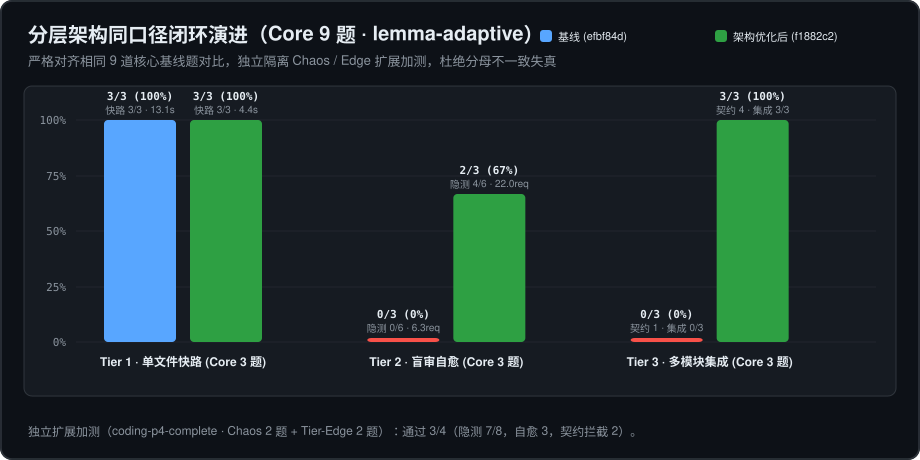

<!-- BRAND_START -->
<div align="center">


<h1>Lemma</h1>

<p><strong>把复杂目标，化为可验证的每一步。</strong></p>


</div>
<!-- BRAND_END -->

**Lemma（引理）是一个基于 [Pi Durable](https://github.com/earendil-works/pi/tree/main/packages/durable)、面向 coding 场景的多 Agent 协同系统。**
它将不同能力的模型与 CLI 组织成有明确职责、独立上下文、结构化交接与独立复核机制的工程团队，完成仓库分析、并行开发、盲审返工、多分支联合集成、自动验收与人工确认合并。

执行与会话状态由 Pi Durable + SQLite 持久化；终端负责下发任务与人工决策，本地后台网页（默认 `http://127.0.0.1:8787`）同步提供实时进度、图谱、代码改动与用量观测。

## 核心特性

- **职责分工与依赖编排**：通过 `.pi-agent/GOAL.md`（目标）与 `.pi-agent/ASSIGN.md`（任务看板）组织工作，支持 `plan_tasks` 依赖图、异步后台派工（`background: true` / `wait_jobs`）及单层子调度（`delegate_to_lead`）。
- **上下文隔离与结构化交接**：成员各自持有独立会话与上下文窗口，不混用全局聊天记录；长结果自动截断预览并持久化全文（`read_result` 按需分页提取，`lemma.delivery.v1` 按字段交接）。
- **路径契约与独立盲审**：支持任务级 `scope: { allow, forbid }` 路径边界（API 写前拦截 + 收尾硬校验），以及 `reviewer: { member, blind }` 独立复核 / 代码盲审（盲审仅审契约与 `git_diff`，剥离执行者自述）。
- **Worktree 隔离与联合集成**：代码任务默认在独立 Git worktree 中执行，支持多分支三方合流集成（`/integrate` / `integrate_changes` + 冲突修复 `repair_integration`）及按目标仓库匹配的 `autonomy.checks` 自动验收与有限修复。
- **人工闸门与可恢复性**：总调度可通过 `request_apply` 在终端弹窗请求合并确认，敏感/分歧仓库推送受人工审批保护；中断、重启或受阻后可在终端直接 `/task inspect|resume|supply|reassign` 续接。

## 快速开始

- **环境要求**：Node.js ≥ 22.19、Git（worktree 隔离需要）；Windows 建议使用 Windows Terminal + PowerShell 7。
- **成员准备**：支持 Claude / Codex / Gemini 本机 CLI（需提前各自登录），也支持直接配置 OpenAI / Anthropic 兼容 API 成员（见 [成员使用说明](docs/custom-agents.md)）。

```bash
git clone https://github.com/wangchneyu/Lemma-pi-durable.git pi-agent
cd pi-agent
npm install
npm start
```

> `npm start` 默认使用真实模式并同时启动本地网页（`--no-web` 可关闭，`--plain` 切换纯文本，`npm start -- "任务"` 单次运行后退出）。直接由 Node TypeScript 原生运行，无需额外构建步骤。

首次使用在终端执行 `/setup` 配置总调度模型与凭据，用 `/agent add` 管理 API 成员；可用 `npm run check`（会产生真实调用）验证各成员连通性。API 密钥经隐藏输入存入本机 `~/.lemma/credentials.json`，配置文件与网页响应仅保留引用。

## 终端速查

| 类别 | 常用命令与快捷键 |
|---|---|
| 任务与协作 | `/tasks` `/ready` `/jobs` `/jobs cancel <ID\|all>` `/workflow pause\|resume` `/task inspect\|resume\|supply\|reassign\|cancel` `/goal` |
| 代码隔离与集成 | `/changes` `/diff <ID>` `/apply [ID\|all]`（交互确认）/ `/drop <ID>` `/clean` `/integrate create\|list\|show\|rerun\|repair\|cancel` |
| 成员与规范 | `/setup` `/agents` `/agent add\|edit\|enable\|disable\|model\|key` `/tool` `/mcp` `/rules [init\|sync]` `/limits edit` |
| 会话与终端交互 | `/session new\|use\|rename` `/sessions` `/abort [all]` `/continue` `/compact` `/usage` `/web`<br>`Ctrl+K` 会话与只读子对话 · `Ctrl+L` (`/model`) 切换模型 · `Alt+C` (`/tree`) 关系树 · `Ctrl+T` (`/taskgraph`) 原生任务面板 · `Ctrl+N`/`Ctrl+O` 新建/切换会话 · `Ctrl+E` 展开输出 · `Alt+T` 思考块 |

## 本地后台网页

网页与终端共享同一套 Harness 状态（仅监听 `127.0.0.1` 并校验 Host/Origin，不可跨站控制或从网页直接派发新任务）：

- **工作台**：**总览**（桑基流向图、实时派工与执行中状态）、**项目**（四格控制台、自适应分工看板、目标与角色分工）、**任务图谱 (`#/dag`)**、**协作时间线 (`#/topology`)**、**运行记录**。
- **明细与版本管理**：**派工明细**（实时输出/详情抽屉）、**改动**（GitLens 风格多仓库提交图谱、差异审阅与受控推送管理）、**成员会话**、**用量**。
- **团队与设置**：**成员**（启停与模型切换）、**Agent 规范**（项目/用户级规则一致性扫描与只读查看）、**配置**（模型、预算与按仓库匹配的自动验收编辑器）。

## 配置概要 (`pi-agent.config.json`)

可通过环境变量 `PI_AGENT_CONFIG` 指定自定义配置文件（保留兼容原 `PI_AGENT_*` 变量与 `.pi-agent/` 规则目录）：

- **`orchestrator`**：总调度 API（`anthropic-compatible` / `openai-compatible` / `builtin`），支持 `modelId`、`modelIds`、`discoverModels`（`GET /v1/models`）与 `price`。
- **`agents`**：CLI 成员（`claude` / `codex` / `gemini`，含 `extraArgs`、`models`、`defaultModel`）及内置工具链的 API 成员（如 `deepseek`，默认受 worktree 路径锁与 `api.bash` 白名单约束）。
- **`roles` / `isolation` / `autonomy` / `budget` / `web`**：角色首选与回退链、Git worktree 快照与依赖目录联接（`linkDirs`）、按目标仓库生效的验收命令（`checks`）与最大修复次数、单轮预算上限与端口设置（默认 `8787`）。

## 效果评测

<!-- BENCH_START -->
以下图表与汇总表均由 `npm run bench:chart`（[render-bench-charts.mjs](scripts/render-bench-charts.mjs)）**直接扫描 `data/benchmarks/` 下实测 JSON 自动渲染**（Tier 1 快路对比去快路请求 **-74%**、耗时 **-91%**；完整归因与逐题报告见 [分层编码评测记录](docs/benchmarks/tiered-coding-evaluation.md)）。最近一次离线全链路回归（`coding-p2-offline`）共 **37 次运行**，`lemma-adaptive` 核心与 `Tier-Edge` 均全量跑通。





### 优化前后演进对照（`lemma-adaptive`）

| 分层 | 基线 `coding-p1-deepseek` (`efbf84d`) | `coding-p1-t23-opt` (`e1589a4`) | `coding-p2-t23edge-r1` (`3c307e7`) |
|---|---:|---:|---:|
| **Tier 1** | 3/3 (100%) · 13.1s | 未重测 | 未重测 |
| **Tier 2** | 0/3 (0%) · 77.3s | **2/3 (67%)** · 隐测 4/6 · 契约拦截 2 · 175.9s | **0/4 (0%)** · 隐测 3/8 · 契约拦截 2 · 249.0s |
| **Tier 3** | 0/3 (0%) · 101.2s | **0/3 (0%)** · 隐测 0/4 · 契约拦截 2 · 166.5s | **1/4 (25%)** · 隐测 1/6 · 契约拦截 7 · 402.5s |

### 全量实验臂实测汇总（JSON 自动聚合）

| 实验臂与批次 | 任务通过率 | 隐藏用例 | 路由准确率 | 平均请求 | 平均耗时 | 总 Token | 费用 | 机制观测 |
|---|---:|---:|---:|---:|---:|---:|---:|---|
| `lemma-adaptive` (基线 (coding-p1-deepseek)) | 3/9 (33%) | 6/16 (38%) | — | 9.9 | 63.9s | 694k | $0.2574 | 快路 3 · 契约拦截 1 |
| `single` (基线 (coding-p1-deepseek)) | 3/9 (33%) | 6/16 (38%) | — | 5.2 | 43.4s | 195k | $0.1134 | — |
| `ablation-no-fastpath` (基线 (coding-p1-deepseek)) | 1/3 (33%) | 2/6 (33%) | — | 27.0 | 148.4s | 753k | $0.2920 | — |
| `ablation-no-blind` (基线 (coding-p1-deepseek)) | 2/3 (67%) | 4/6 (67%) | — | 16.7 | 80.1s | 363k | $0.0980 | — |
| `ablation-no-scope` (基线 (coding-p1-deepseek)) | 0/3 (0%) | 0/4 (0%) | — | 14.0 | 81.4s | 360k | $0.1698 | 契约拦截 1 |
| `lemma-adaptive` (P1-opt T2+T3 (coding-p1-t23-opt)) | 2/6 (33%) | 4/10 (40%) | — | 18.8 | 171.2s | 1.07M | $0.4947 | 契约拦截 4 |
| `lemma-adaptive` (P2 T2+T3 (coding-p2-t23edge-r1)) | 1/8 (13%) | 4/14 (29%) | 2/8 (25%) | 29.3 | 325.8s | 2.90M | $1.3713 | 契约拦截 9 · 自愈 1 · 集成 1 · 门禁 2 |
| `lemma-adaptive [Tier-Edge]` (独立边缘防御 (coding-p2-t23edge-r1)) | 1/2 (50%) | 3/4 (75%) | 2/2 (100%) | 29.0 | 223.5s | 623k | $0.1919 | 契约拦截 1 · 自愈 1 |
<!-- BENCH_END -->

## 测试与评测

```bash
npm run typecheck          # TypeScript 类型检查
npm test                   # 全量离线集成测试（faux 模型 + scripts/fake-agent.mjs，不消耗真实 API）
npm run bench:coding       # 分层编码基准与消融（加 -- --real 使用真实模型）
```

常用专项测试与基准脚本：`test:collaboration`（集成/盲审/契约/快慢路径/基准套件）、`test:conversations`（多会话切换/Git 工作台/网页控制）、`test:terminal`（终端组件与交互）、`bench:context`（[上下文裁剪初始记录](docs/benchmarks/initial-context-ablation.md)）与 `bench:collaboration`。

## 代码结构

- `src/main.ts`、`src/app.ts`：CLI 入口、Pi Durable Harness 初始化、进程锁与后台联动。
- `src/terminal.ts`、`src/terminal-state.ts`、`src/native-*.ts`、`src/printer.ts`：终端交互、Pi Coding Agent 官方组件复用与流式状态。
- `src/tools.ts`、`src/dispatch.ts`、`src/agents.ts`、`src/cli-runner.ts`、`src/api-member.ts`、`src/lead.ts`：派工引擎、CLI/API 成员接入、只读代码工具（`src/code-tools.ts`）与子调度。
- `src/board.ts`、`src/task-*.ts`、`src/scope.ts`、`src/jobs.ts`、`src/repair.ts`、`src/learning.ts`：分工表、依赖就绪、自动推进、独立复核、受阻恢复与有限自动修复。
- `src/git.ts`、`src/changes.ts`、`src/change-ops.ts`、`src/integrations.ts`、`src/integration-git.ts`、`src/git-workbench.ts`：worktree 隔离、改动管理、多分支联合集成、推送审批与终端合并交互。
- `src/admin.ts`、`src/view.ts`、`web/`：本地 HTTP/SSE 服务与无构建 ES Module 后台界面（总览、项目、任务图谱、协作时间线、改动工作台等）。
